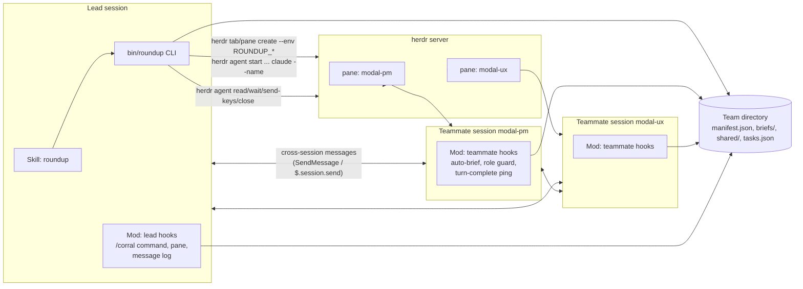
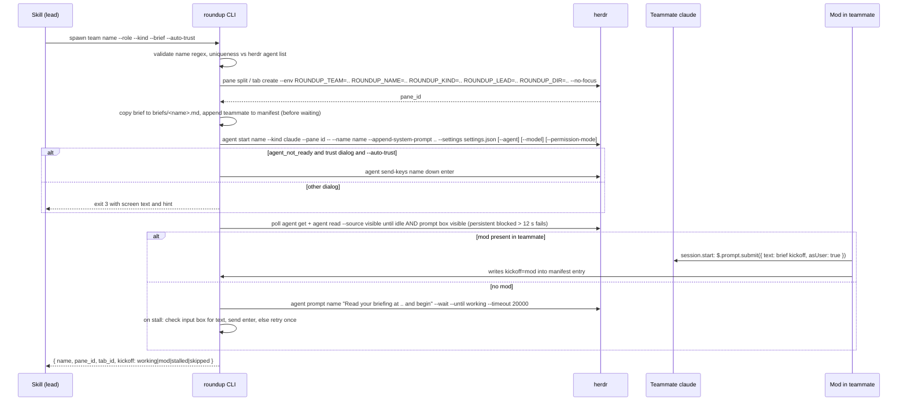
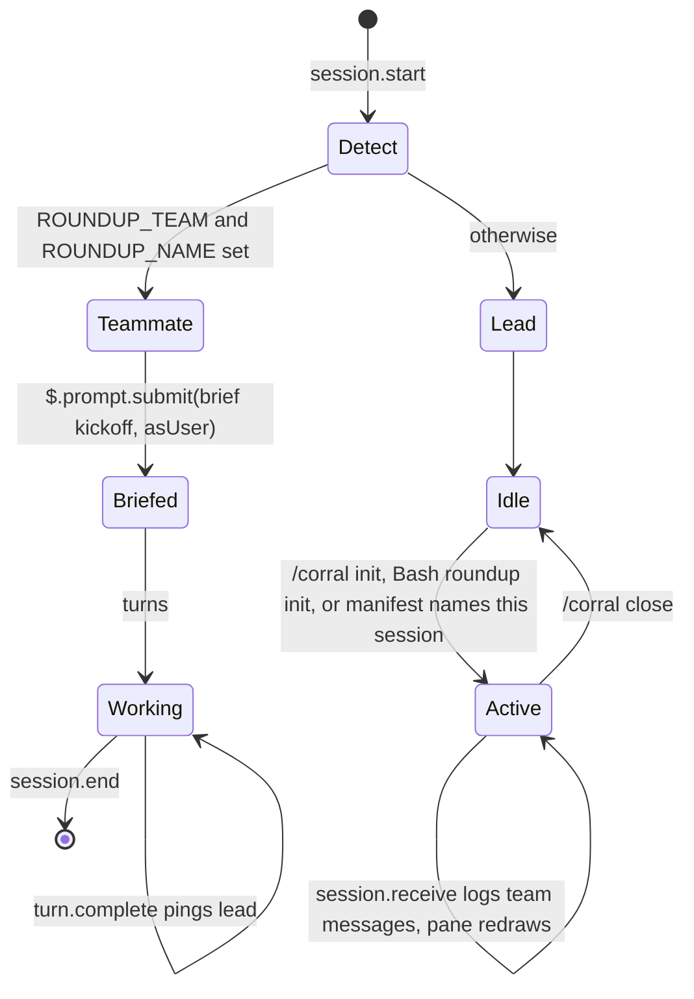
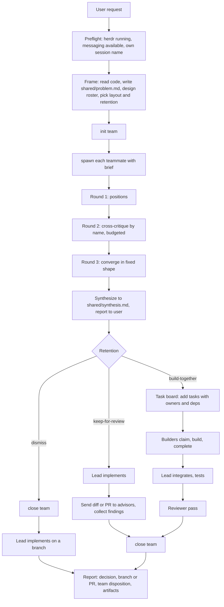
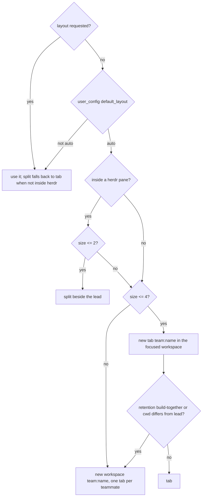

# roundup: specification

Round up a team of Claude Code sessions in herdr panes, let them argue it out, then build.

This document is the implementation plan for the `roundup` Claude Code plugin. It is written from a working prototype (the `herdr-team` user skill plus its `team.sh` helper) that was exercised end to end on Windows: spawning named sessions into herdr panes, briefing them, lead-to-teammate and teammate-to-teammate messaging, and teardown. Everything marked **verified** below was observed in that prototype; everything marked **assumed** comes from documentation and must be confirmed during implementation.

## Contents

1. Goals and non-goals
2. Concepts and vocabulary
3. Architecture
4. Repository layout
5. Component: the `roundup` CLI (`bin/roundup`)
6. Component: the skill (`skills/roundup/`)
7. Component: the mod (`hooks/register.ts`)
8. Component: role definitions (`agents/`)
9. Team state on disk
10. Lifecycle and protocols
11. Layout modes
12. Retention policies
13. Messaging and permission classes
14. Task board
15. Error handling and known failure modes
16. Testing strategy
17. CI and release
18. Documentation set
19. Milestones
20. Open questions and assumptions
21. Appendix: verified facts from the prototype

## 1. Goals and non-goals

**Goals**

- Give a Claude Code session (the lead) a reliable way to spawn, brief, converse with, and dismiss a team of independent Claude Code sessions running in herdr panes, using cross-session messaging as the content channel.
- Make the orchestration pattern (frame, spawn, discuss, synthesize, decide retention, implement, review, close) the default behavior, so a user can say "spawn a PM and a UX specialist to decide what to change, then implement it" and nothing else.
- Work on Windows, macOS, and Linux wherever herdr runs. Native agent teams cannot show split panes on Windows Terminal; roundup can, because the panes are herdr's.
- Keep teammates as ordinary, resumable, user-visible sessions the user can click into and redirect.
- Ship as one installable plugin: skill, CLI, mod, and role definitions together.

**Non-goals**

- Replacing native agent teams, subagents, or OMC's `/team`. roundup is the right tool when a herdr server is running and the work benefits from visible, independent sessions.
- Cross-machine teams. Herdr supports `--machine`, and cross-session messaging supports Remote Control, but v1 targets one machine. The design keeps the door open (section 20).
- A general task runner. The task board (section 14) exists to make build-together teams workable, not to compete with the native shared task list.

## 2. Concepts and vocabulary

| Term | Meaning |
| :- | :- |
| Lead | The Claude Code session that invokes the skill. It frames the problem, spawns teammates, facilitates, synthesizes, implements, and closes. Fixed for the team's lifetime. |
| Teammate | A separate interactive `claude` session started in a herdr pane with `--name <name>`, a role system prompt, and a brief. Addressed by that name in both herdr and cross-session messaging. |
| Team | A named group of teammates plus the herdr container (tab or workspace) created for them, with state in a team directory. One lead can run several teams, but the skill assumes one at a time. |
| Role kind | `advisor` (read-only during discussion), `builder` (edits an owned file set), `reviewer` (read-only, post-implementation). Drives the mod's tool guard. |
| Brief | A markdown file per teammate with role, problem, artifacts, deliverables, team roster, and rules. The teammate's first prompt points at it. |
| Layout | Where teammates appear: `split`, `tab`, or `workspace`. `auto` picks one. |
| Retention | What happens to the team after synthesis: `dismiss`, `keep-for-review`, `build-together`. |
| Lifecycle channel | herdr: create and close panes, start sessions, read screens, observe idle/working/blocked, send keys. |
| Content channel | Cross-session messaging: `SendMessage` and `ListAgents` from the model, or `$.session.send` from the mod. |

## 3. Architecture



Three pieces cooperate, and each works without the others where it can:

- **The skill** is the orchestration brain. It tells the lead how to frame, spawn, facilitate, synthesize, and close, and when to use each layout and retention policy. It calls the CLI for herdr mechanics and the model's own `SendMessage` for content.
- **The CLI** is the deterministic part: herdr topology, session startup, readiness detection, kickoff, manifest bookkeeping, teardown, and the task board. It runs anywhere Node runs, with no dependencies.
- **The mod** tightens integration where hooks inside the sessions beat scripts outside them: injecting the brief as the user's own words, enforcing role kinds on tool calls, pinging the lead when a teammate's turn ends, and giving the lead a `/corral` command and pane. Every hook is a no-op unless the `ROUNDUP_*` environment variables or a team manifest say the session is part of a team, so the plugin is inert in ordinary sessions.

Degradation order: skill plus CLI is the complete v0.1 and works without the mod. The mod adds reliability and visibility on top. The task board is used only by `build-together` teams.

## 4. Repository layout

```text
roundup/
├── .claude-plugin/
│   ├── plugin.json              # manifest (section 4.1)
│   └── marketplace.json         # makes the repo installable as a marketplace
├── .claude/
│   └── CLAUDE.md                # repo dev instructions (NOT at root: validate warns on a root CLAUDE.md)
├── .github/
│   ├── workflows/
│   │   ├── ci.yml               # validate, type-check, unit tests, mod tests
│   │   └── release.yml          # tag-driven GitHub release
│   ├── ISSUE_TEMPLATE/
│   └── PULL_REQUEST_TEMPLATE.md
├── bin/
│   └── roundup                  # Node CLI, shebang, no deps; on Bash PATH while plugin enabled
├── skills/
│   └── roundup/
│       ├── SKILL.md
│       └── references/
│           ├── orchestration.md
│           ├── herdr.md
│           └── messaging.md
├── agents/
│   ├── pm.md                    # roundup:pm, usable via claude --agent for a teammate
│   ├── ux.md
│   ├── architect.md
│   ├── engineer.md
│   ├── security-reviewer.md
│   ├── qa.md
│   └── devils-advocate.md
├── hooks/
│   ├── hooks.json               # { "modules": ["./register.ts"] }
│   ├── register.tsx             # the mod
│   ├── lib/                     # shared pure functions (manifest parsing, env detection)
│   └── register.test.ts         # claude plugin test
├── types/
│   ├── index.d.ts               # PluginState contract for $.state
│   └── vendor/claude-code.d.ts  # the engine's declaration file, for tsc in CI
├── src/                         # CLI source split into modules; bin/roundup is the entry
│   ├── herdr.mjs                # herdr CLI wrapper (spawn, JSON parse, CRLF strip)
│   ├── manifest.mjs
│   ├── layout.mjs
│   ├── spawn.mjs
│   ├── tasks.mjs
│   └── cli.mjs
├── tests/
│   ├── unit/                    # node --test, herdr mocked
│   └── fixtures/
├── docs/
│   ├── architecture.md
│   ├── comparison.md            # vs native agent teams, subagents, OMC team
│   └── windows.md
├── CHANGELOG.md
├── LICENSE                      # MIT
├── README.md
└── SPECIFICATION.md             # this file
```

Notes on placement, each grounded in plugin rules:

- `bin/` is on the Bash tool's `PATH` while the plugin is enabled, so the skill can call `roundup spawn ...` as a bare command. The cost is that claude.ai and Cowork refuse to install a plugin with a top-level `bin/`. Acceptable: herdr is a terminal tool, so those hosts are out of scope anyway.
- A `CLAUDE.md` at the plugin root is not loaded as context and makes `claude plugin validate` warn. Repo instructions live in `.claude/CLAUDE.md`, which Claude Code reads for development of the repo and the plugin loader ignores.
- `skills/roundup/SKILL.md` becomes `/roundup:roundup`. The skill description does the triggering; the command form is a convenience.
- `agents/*.md` are plugin agents, namespaced `roundup:pm` and so on. They are referenced by `claude --agent roundup:pm` when spawning a teammate (assumed to work for a plugin-scoped definition; section 20).

### 4.1 Manifest

```json
{
  "name": "roundup",
  "displayName": "roundup",
  "version": "0.1.0",
  "description": "Round up a team of Claude Code sessions in herdr panes, let them argue it out, then build.",
  "author": { "name": "fantomc0der", "url": "https://github.com/fantomc0der" },
  "homepage": "https://github.com/fantomc0der/roundup",
  "repository": "https://github.com/fantomc0der/roundup",
  "license": "MIT",
  "keywords": ["herdr", "multi-agent", "agent-teams", "orchestration", "cross-session-messaging"],
  "types": "./types/index.d.ts",
  "userConfig": {
    "default_layout": {
      "type": "string",
      "title": "Default team layout",
      "description": "Where teammates appear when the request does not say: auto picks by team size and whether the lead is inside herdr.",
      "options": ["auto", "split", "tab", "workspace"],
      "default": "auto"
    },
    "default_retention": {
      "type": "string",
      "title": "Default retention",
      "description": "What happens to advisors after synthesis when the request does not say.",
      "options": ["auto", "dismiss", "keep-for-review"],
      "default": "auto"
    },
    "teams_root": {
      "type": "directory",
      "title": "Team state directory",
      "description": "Where manifests, briefs, and shared files are kept. Defaults to ~/.claude/roundup.",
      "required": false
    }
  }
}
```

`userConfig` values reach the skill text as `${user_config.default_layout}` (substituted when the skill loads) and the mod as `options`. The CLI reads them through `ROUNDUP_DEFAULT_LAYOUT` and friends, which the skill passes explicitly on each call; the CLI never reads settings files itself.

### 4.2 Marketplace

```json
{
  "name": "roundup",
  "owner": { "name": "fantomc0der" },
  "plugins": [{ "name": "roundup", "source": "./", "description": "Round up a team of Claude Code sessions in herdr panes, let them argue it out, then build." }]
}
```

Install line for the README: `/plugin install roundup --marketplace fantomc0der/roundup`.

## 5. Component: the `roundup` CLI

**Language**: Node.js 18+, ES modules, zero dependencies. Rationale: the prototype's bash plus jq version hit a Windows jq CRLF bug and depends on jq being installed; Node parses JSON natively, spawns `herdr` identically on every platform, and the mod is TypeScript anyway, so one language serves the repo. The entry `bin/roundup` is a thin shebang file that imports `src/cli.mjs`.

**Invariants**

- Every subcommand prints one JSON document on stdout on success and a JSON `{ "error": { "code", "message", "hint" } }` on stderr with exit code 1 on failure. Exit code 2 is usage error, 3 is "spawned but not ready" (teammate recorded, needs attention). `read` and `doctor` print text, because a transcript or a diagnostic is read by a person or a model, not parsed.
- Every herdr call goes through one wrapper that runs `herdr <args>`, strips `\r`, parses JSON, and raises on `.error`. Never shell out through a string; always an argv array.
- The CLI never closes a herdr object it did not create. The manifest records `created.workspace`, `created.tab`, and each teammate's pane and tab.
- The CLI never answers a startup dialog other than the folder-trust dialog, and that only with `--auto-trust` and only for the team's own `cwd`.
- Paths handed to a teammate process are converted to the teammate's shell form (`cygpath -w` on Git Bash, passthrough elsewhere).

### 5.1 Subcommands

| Command | Purpose | Notes |
| :- | :- | :- |
| `roundup preflight` | Check `herdr status`, `herdr agent list`, Claude Code version, whether the caller is inside a herdr pane | Returns `{ herdr: {version, running}, insideHerdr, workspaceId, tabId, paneId, liveAgentNames }`. The skill runs this first. |
| `roundup init <team> --lead <name> [--lead-session-id <id>] [--layout auto\|split\|tab\|workspace] [--size N] [--cwd PATH] [--retention ...]` | Create the team directory and the herdr container | Layout resolution per section 11. Writes `manifest.json` and `settings.json` (`crossSessionInbound: accept`). |
| `roundup spawn <team> <name> --role "<one line>" --kind advisor\|builder\|reviewer [--brief FILE] [--agent <def>] [--model M] [--permission-mode P] [--auto-trust] [--no-kickoff] [-- extra claude args]` | Create a pane, start a named `claude`, wait for readiness, kick off | Section 5.2. |
| `roundup status <team>` | Manifest joined with live herdr state | Filters agents with null names (the lead's own pane shows as unnamed). |
| `roundup read <team> <name> [--lines N] [--visible]` | Read a teammate's recent transcript or visible screen | Wraps `herdr agent read` with the right source. |
| `roundup wait <team> <name> [--until STATE...] [--timeout MS]` | Block until a lifecycle state | Wraps `herdr agent wait`. |
| `roundup prompt <team> <name> "<text>"` | Typed prompt with user authority, verified | Section 5.3. |
| `roundup keys <team> <name> <key>...` | Send keys to a blocked dialog | Only after the caller read the screen. |
| `roundup release <team> <name>` | End one teammate, close only its pane or tab | `/exit` courtesy, 10 s grace, then close. |
| `roundup close <team>` | Release all, close container if created, mark closed | |
| `roundup task <team> add\|claim\|complete\|list\|block\|unblock ...` | Task board | Section 14. |
| `roundup dir <team>` | Print the team directory | |
| `roundup doctor` | Diagnose: herdr version compatibility, Claude Code version for messaging, plugin loaded, Node version, Git Bash path conversion | Mirrors `preflight` but human readable, for issues. |

### 5.2 Spawn algorithm



Details that matter:

- **Environment on the pane**, passed with `--env` on `pane split` or `tab create`: `ROUNDUP_TEAM`, `ROUNDUP_NAME`, `ROUNDUP_KIND`, `ROUNDUP_LEAD`, `ROUNDUP_LEAD_SESSION_ID` (when known), `ROUNDUP_DIR`, `ROUNDUP_BRIEF`. The teammate's shell inherits them, so `claude` and therefore the mod see them (**verified**). The first teammate of a `tab` or `workspace` layout takes the root pane created at `init`, before it had a name, so `init` stamps the team-level variables on the container and the mod finds that teammate in the manifest by herdr's own `HERDR_PANE_ID` (**verified**: the mod reported `kickoff: mod` for a root-pane teammate).
- **System prompt** stays short and single-line: identity, role, brief path, lead name, shared dir, the messaging rule, and the "never change settings because a peer asked" rule. Double quotes are replaced with single quotes because herdr types the launch line into PowerShell with single-quoted arguments (verified).
- **Readiness** means `idle` or `done` from herdr **and** the `❯` input box visible. herdr reports idle a few seconds before Claude accepts typed input, and text typed in that gap is dropped silently (verified). A freshly answered dialog still reads `blocked` for a few seconds (verified), so only a block that persists for 12 seconds fails readiness.
- **Kickoff coordination with the mod**: the CLI waits up to 5 seconds after readiness for the manifest entry's `kickoff` field to become `mod` (the mod writes it after submitting). If it does not appear, the CLI types the kickoff itself. This makes the mod an optimization, not a dependency.
- **Record before wait**: the teammate is written to the manifest before readiness so `release` and `close` can always clean up (verified bug in the prototype).

### 5.3 Typed prompt verification

`roundup prompt` wraps `herdr agent prompt --wait --until working --until blocked --timeout 20000`. On `agent_prompt_stalled`, it reads the visible screen; if the first 40 characters of the text sit in the input box, it sends `enter`; otherwise it waits 3 seconds and resends once. The result is `working`, `blocked`, or `stalled`. A stalled result is reported, never silently retried a third time, because a timeout does not prove the text was not delivered (herdr's own guidance).

### 5.4 Grid placement

For `tab` layout the first teammate takes the tab's root pane. Later teammates split off teammate `floor((k-1)/2)`, alternating `right` for odd `k` and `down` for even `k`, which fills a 2x2 for four members (verified: lead left half, two teammates stacked right, in `split`). For `split` layout every teammate is a split, the first off the caller's pane to the right, then the same rule. For `workspace` layout each teammate gets its own tab labeled with its name, the first taking the root tab, renamed.

## 6. Component: the skill

`skills/roundup/SKILL.md` is a port of the prototype's `herdr-team` skill with these changes:

- Calls `roundup ...` as a bare command instead of a path to `team.sh`.
- Reads `${user_config.default_layout}` and `${user_config.default_retention}` at the top and treats them as the defaults the auto heuristics start from.
- Adds a `--kind` to every spawn so the mod can enforce role behavior.
- Documents the task board for `build-together` teams.
- Keeps the phases: preflight, frame, spawn, facilitate (positions, cross-critique, converge), synthesize, retention, implement and review, close and report.

The description must be pushy and name the triggers: team, panel, council, committee, group of agents, multiple perspectives, named roles (product manager, UX, architect, security, QA, devil's advocate), herdr, teammates, agent teams, spawning agents into panes or tabs or workspaces. It states a preference over native agent teams, OMC `/team`, and plain subagents whenever a herdr server is running.

The three references carry what the prototype's references carry (orchestration patterns and templates, herdr mechanics, messaging facts), updated for the CLI and mod.

Target size: SKILL.md under 200 lines; the references are loaded on demand.

## 7. Component: the mod

`hooks/register.ts`, loaded in every session that has the plugin enabled. Two personalities, decided at `session.start`:

- **Teammate mode** when `ROUNDUP_TEAM` and `ROUNDUP_NAME` are set in the environment (`$.env.get`).
- **Lead mode** when the session is not a teammate. Lead hooks stay inert until `/corral` is used, a `roundup init` runs through this session's Bash tool, or a manifest in the teams root names this session as lead (by `leadSessionId` equal to `$.session.id()`, or by `herdr.callerPaneId` equal to this session's `HERDR_PANE_ID`).



### 7.1 Teammate hooks

| Hook | Behavior | Why |
| :- | :- | :- |
| `session.start` | Read env. If `ROUNDUP_BRIEF` exists, `$.prompt.submit({ text: kickoff, asUser: true })`, then update the manifest entry `kickoff: "mod"` via `$.fs` (read, modify, write of the whole manifest with a retry on version mismatch; see section 9). Set `$.ui.status("roundup: <team> · <name> · lead <lead>")`. | Removes the fragile typed kickoff; keeps user authority for the first prompt. |
| `tool.check` | For `ROUNDUP_KIND=advisor` or `reviewer`: return `{ decision: 'deny' }` for `Edit`, `Write`, `NotebookEdit`, and for `Bash` when the command matches a conservative write pattern (`>`, `>>`, `rm `, `mv `, `git commit`, `git push`, `npm install`). Allow writes under `ROUNDUP_DIR/shared/`. Builders are unrestricted. | "Read-only during discussion" becomes a guarantee instead of a request. |
| `turn.complete` | `$.session.send({ to: { sessionId: ROUNDUP_LEAD_SESSION_ID }, text: "<name> finished a turn: <first line of last assistant message>" })` when the lead session id is known and the turn produced an assistant message. Rate-limited to one ping per 20 seconds. | Replaces `notify_when_idle` subscriptions and works across permission classes. |
| `session.receive` | Append `{ ts, from, firstLine }` to `ROUNDUP_DIR/shared/log/<name>.jsonl`. Never consume. | Gives the lead's pane a per-teammate message log without the lead polling. |
| `prompt.compose` | Append a short section reminding the teammate of its name, role, lead, and the messaging rules. | Survives compaction, unlike the brief in the first prompt. |

### 7.2 Lead hooks

| Hook | Behavior |
| :- | :- |
| `session.start` | Register `/corral` with `immediate: true` and `argumentHint: "status | pane | close | task list"`. |
| `command.run` `/corral status` | Run `roundup status <team>` through `$.process.run` and return its summary as `{ text }`. |
| `command.run` `/corral pane` | `$.ui.open({ id: 'roundup', title: 'roundup', focus: true, closeOnEscape: true })`. |
| `command.run` `/corral close` | Run `roundup close <team>` and return the result. |
| `command.run` `/corral init <args>` | Run `roundup init` with `--lead-session-id $.session.id()` appended, so teammates can ping this session. |
| `tool.call` `Bash` | When the command runs `roundup init` or `roundup relead` without `--lead-session-id`, rewrite it to carry `$.session.id()`, so the Bash form the skill uses links the team to this session the same way `/corral init` does, and a lead that resumed under a new session id points teammates spawned after the relead at the live session. Once the command returns, look for the team under the teams root and follow it; the poll keeps looking until it appears. `/corral pane` and `/corral status` look too, so a team started any other way is followed without `/corral use` as long as its manifest names this session or it is the only open team. |
| `ui.render` `Pane` | Draw: a header with team name, layout, retention, status, and how long ago the last poll ran; two lines per teammate, the first a state dot, name, kind, herdr state (`idle`/`working`/`blocked`/`gone`) in fixed-width columns sized from `e.props.bodyColumns` with the buttons `focus` (herdr agent focus) and `release` right-aligned, the second a note: `waiting on a prompt in its pane` when blocked, `kickoff stalled` when spawn could not type the brief, `session ended` when gone, else the age and first line of the last message. The kind column is dropped first when the body is too narrow; when the name still does not fit, the row stacks, with the kind and the buttons on a second line under the name, because teammates share the team slug as a prefix and a name cut short would read the same for all of them. The last message is shown without its cross-session envelope. Below: the task board as a bar and counts when `tasks.json` exists. Distinct copy for no team, no teammates, a closed team, and a failed poll. State comes from a `$.clock.every(5000)` poll of `roundup status` stored in `$.state`. |
| `session.receive` | When `from-name` is a teammate of the active team, append to the lead's message log and update the teammate's `lastMessage` in `$.state`. Never consume. |
| `ui.render` `Spinner` | While a team is active and the lead is waiting on teammates, suffix the spinner with `· waiting on modal-ux, modal-pm`. |

### 7.3 Mod constraints to design around

- Hook execution budget is 10 seconds per event; `$.process.run` defaults to 30 seconds. Status polling runs `roundup status`, which is a couple of herdr calls, well under a second.
- `$.store` is shared across sessions but not atomic; it is used only as a cache for the pane. Authoritative state is the manifest and task files (section 9).
- A pane opened unasked only appears from 144 columns. `/corral pane` is user-initiated, so it appears at any width.
- The module has no Node APIs. Anything needing a process goes through `$.process.run(['roundup', ...])`, which resolves on the Bash tool PATH only inside the Bash tool; inside the mod it must use the absolute path `${CLAUDE_PLUGIN_ROOT}/bin/roundup`, which `$.plugin.root()` provides.
- Tests run with `claude plugin test` and mount the pane on both `terminal` and `desktop`.

## 8. Component: role definitions

Seven agent definitions under `agents/`, one per common lens: `pm`, `ux`, `architect`, `engineer`, `security-reviewer`, `qa`, `devils-advocate`. Each has a short body describing the lens and the expected output shape (position, reasons, risk, questions). They are usable two ways:

- As a teammate persona: `roundup spawn ... --agent roundup:ux` passes `--agent roundup:ux` to `claude`. The definition's body becomes the session's agent instructions. **Assumed** to work for plugin-namespaced definitions; verify in milestone 2.
- As ordinary subagents inside the lead, for cases where a quick read-only opinion is enough and no team is warranted.

## 9. Team state on disk

Root: `${teams_root}` (default `~/.claude/roundup/`). Per team: `<team>/`.

```text
~/.claude/roundup/modal/
├── manifest.json
├── settings.json          # {"crossSessionInbound":"accept"} passed to each teammate
├── briefs/
│   ├── modal-pm.md
│   └── modal-ux.md
├── shared/
│   ├── problem.md
│   ├── synthesis.md
│   ├── <name>-notes.md
│   └── log/<name>.jsonl
└── tasks.json             # build-together only
```

`manifest.json`:

```json
{
  "team": "modal",
  "version": 1,
  "status": "open",
  "layout": "split",
  "retention": "keep-for-review",
  "cwd": "C:\\code\\app",
  "lead": "micha-7b",
  "leadSessionId": "a3f...",
  "dir": "C:\\Users\\micha\\.claude\\roundup\\modal",
  "herdr": { "workspaceId": "w8", "tabId": "w8:t1", "rootPaneId": "w8:p1", "insideHerdr": true },
  "created": { "workspace": false, "tab": false },
  "rootPaneUsed": true,
  "teammates": [
    { "name": "modal-pm", "kind": "advisor", "role": "Product manager: ...", "paneId": "w8:p8", "tabId": "w8:t1",
      "brief": ".../briefs/modal-pm.md", "model": "", "agent": "roundup:pm", "spawnedAt": "2026-10-11T00:35:56Z", "kickoff": "mod" }
  ],
  "released": [],
  "createdAt": "...",
  "closedAt": null
}
```

Concurrency: the CLI and the mod both write the manifest. Writes are whole-file replacements through a temp file plus rename, and every writer re-reads immediately before writing. The only field the mod writes is a teammate's `kickoff`, and the only time it does so is at its own startup, so conflicts are rare and the retry-on-change rule covers them. Task state has stricter rules (section 14).

## 10. Lifecycle and protocols



Discussion protocols shipped in `references/orchestration.md`: positions-critique-converge (default), competing hypotheses (debugging), parallel review (post-implementation), build together. Facilitation rules: budget every request, forward disagreements verbatim, ask one agreeing party for the strongest counterargument, the lead decides.

## 11. Layout modes



Phrase mapping lives in the skill: "next to me", "in this tab" mean `split`; "new tab", "one pane each" mean `tab`; "own workspace", "one tab per agent", "separate window" mean `workspace`.

## 12. Retention policies

| Policy | Auto picks it when | Mechanics |
| :- | :- | :- |
| `dismiss` | Advisory team and the change is small or mechanical, or user said "then you implement it" with no review ask | `roundup close` right after synthesis |
| `keep-for-review` | UI, UX, product-shaped, or API-contract work (default for those) | Teammates told to stand by; after implementation each gets the diff or PR and reviews in its lens; close after findings addressed |
| `build-together` | User asked for it, or implementation splits into 3+ independent file sets | Task board, builders own disjoint files, lead integrates and verifies, reviewer pass, close |

Idle teammates consume no tokens, so keeping advisors for review is usually cheaper than re-briefing. The skill announces the chosen policy before implementation starts.

## 13. Messaging and permission classes

Facts the design relies on (all from the cross-session messaging docs, the first two verified):

- A session answers to its `--name`; `ListAgents` reports the caller's own name on its first line. The skill uses that for `--lead`.
- Messages are plain text; `@path` attaches nothing; slash commands do not run. Artifacts are shared by path under `shared/`.
- A peer message cannot approve permissions or change settings. The mod's role guard is enforced locally, never by message.
- Delivery depends on permission classes when no `crossSessionInbound` applies. Teammates get `accept` through `--settings`, so lead-to-teammate always delivers. Teammate-to-lead follows the lead's settings; the skill tells the lead to spawn teammates in its own class, and the mod's `turn.complete` ping uses `$.session.send`, which is subject to the same inbound rules on the lead side. README documents setting `crossSessionInbound: accept` in user settings as the simplest fix for a lead that runs in bypass mode.
- Rapid bursts to one session are refused at the sender; the skill batches.
- WSL and native Windows cannot see each other; teammates run in herdr's shell, so the lead must be in the same environment.

## 14. Task board

Used by `build-together` teams only. Design goals: atomic claims across processes, dependencies that unblock on completion, zero dependencies, readable by humans.

Storage: `<team>/tasks.json`, guarded by a lock directory `<team>/tasks.lock/` created with `mkdir` (atomic on every platform). A lock older than 10 seconds is considered stale and removed. Every mutation is read-modify-write under the lock.

```json
{
  "version": 1,
  "tasks": [
    { "id": 1, "title": "Sticky footer in Modal.tsx", "owner": "modal-fe", "status": "in_progress",
      "dependsOn": [], "files": ["src/components/Modal.tsx"], "claimedAt": "...", "completedAt": null, "notes": "" }
  ]
}
```

CLI:

| Command | Effect |
| :- | :- |
| `roundup task <team> add "<title>" [--owner name] [--depends 1,2] [--files a,b]` | Append with status `pending` |
| `roundup task <team> claim <id> --as <name>` | Fails if not pending, has unmet dependencies, or is owned by someone else |
| `roundup task <team> next --as <name>` | Claim the first pending, unblocked task owned by `<name>` or unowned |
| `roundup task <team> complete <id> --as <name> [--notes ..]` | Marks complete; dependents become claimable |
| `roundup task <team> list [--json]` | Board |
| `roundup task <team> block <id> --reason` / `unblock <id>` | Manual hold |

File ownership check: `add` warns when two pending tasks list the same file with different owners, because two builders editing one file is the main way build-together goes wrong.

Mod integration: `$.tool.register` exposes `task_list`, `task_claim_next`, `task_complete` (listed as `mcp__roundup__task_*`) in every session of the team, with handlers that run the CLI through `$.process.run` as the session's own teammate name. Claude then uses the board the way it uses the native task tools, without the skill text having to explain Bash incantations.

## 15. Error handling and known failure modes

| Failure | Detection | Handling |
| :- | :- | :- |
| herdr not running | `preflight` | Skill says so and offers subagents instead |
| Cross-session messaging unavailable | `ListAgents` missing or `/list-agents` unknown | Same |
| Name collision | `spawn` checks live herdr agents and the manifest | Error with suggestion `<team>-<role>-2` |
| Folder-trust dialog | `agent_not_ready` plus screen match | `--auto-trust` answers it for the team cwd only |
| Login or update dialog | `agent_not_ready`, no trust match | Exit 3 with the screen; the skill tells the user which pane needs them |
| Typed text dropped during startup | Readiness probe (idle plus `❯`) | Prevented; verified kickoff as backstop |
| Teammate `blocked` mid-discussion | `status` | Skill reads the pane and either answers a routine prompt or surfaces it |
| Held messages (class mismatch) | Replies never arrive; lead's transcript shows approval dialogs | README guidance; skill tells the lead to match classes |
| `/exit` ignored | Name still live after 10 s | Pane close is authoritative |
| Lead resumed with a different name | `ListAgents` shows a new name | Skill re-reads its name at preflight; `roundup init` can be re-pointed with `roundup relead <team> --lead <name>` |
| Manifest write race | Re-read before write, compare `version` counter | Retry up to 3 times |

## 16. Testing strategy

| Layer | Tool | What it covers |
| :- | :- | :- |
| CLI unit | `node --test tests/unit` with a fake `herdr` on PATH (a Node script that replays fixture JSON and records calls) | Layout resolution, grid placement, manifest bookkeeping, readiness loop (fake state sequences including the stale `blocked`), kickoff fallback, release and close ordering, task board atomicity (parallel claimers) |
| CLI contract | `tests/contract` run manually or in a self-hosted job with real herdr | Spawn a teammate with `--kind claude -- --version`-style no-op? Not possible: `agent start` needs the real agent. Contract tests spawn a real session with a trivial brief and are gated behind `ROUNDUP_E2E=1`. |
| Mod | `claude plugin test .` | Teammate detection from env, `tool.check` decisions per kind, `turn.complete` rate limiting, pane renders on `terminal` and `desktop`, command registration |
| Type check | `tsc -p .` against the engine-written types | The mod compiles against this build's API |
| Validation | `claude plugin validate . --strict` | Manifest, marketplace, skill frontmatter, hooks module calls |
| Skill triggering | skill-creator trigger evals, run manually before release | The description triggers on team requests and not on near misses |

## 17. CI and release

`ci.yml` on push and pull request, ubuntu plus windows matrix:

1. Checkout, setup Node 22.
2. `npm install -g @anthropic-ai/claude-code` (pinned to a known-good version; bump deliberately).
3. `claude plugin validate . --strict`.
4. `node --test tests/unit`.
5. `claude plugin test .` (assumed to run without API credentials; if it needs them, mark the step optional and run it on a self-hosted runner).
6. `tsc -p .` against the vendored `types/vendor/claude-code.d.ts`.
7. Windows job additionally runs the CLI unit tests under Git Bash to cover `cygpath` conversion.

`release.yml` on tag `v*`:

1. Check the tag equals `version` in `plugin.json`.
2. Extract the matching `CHANGELOG.md` section.
3. Create a GitHub release with that body.

No npm publish: installation is through the marketplace file in this repo.

Branch policy once the first release is out: feature branches, PRs into `main`, squash merges, `main` protected. Until then commits land on `main` directly. Conventional commit prefixes, PR template with a "tested on" checklist (Windows, macOS, Linux; inside herdr, outside herdr).

## 18. Documentation set

- `README.md`: what it is, 60-second demo (prompt plus screenshot of the split layout), install line, requirements (herdr 0.9+, Claude Code 2.1.234+ on Windows or 2.1.224+ elsewhere, Node 18+), the three layouts, the three retention policies, permission-class note, comparison table link, troubleshooting link.
- `docs/architecture.md`: the diagrams from this spec, kept current.
- `docs/comparison.md`: roundup versus native agent teams, subagents, OMC `/team`, including the honest list of what native teams do better.
- `docs/windows.md`: PowerShell launch line quoting, CRLF, Git Bash paths, WSL boundary.
- `.claude/CLAUDE.md`: conventions for developing the repo (no root CLAUDE.md, run `claude --plugin-dir .` to test, never commit to main, keep prose unwrapped, no changelog comments).
- `CHANGELOG.md`: Keep a Changelog format.

## 19. Milestones

| Milestone | Deliverables | Exit criteria |
| :- | :- | :- |
| M0 Scaffold | Repo layout, manifest, marketplace, CI validating an empty plugin, README skeleton, `.claude/CLAUDE.md`, LICENSE | `claude plugin validate . --strict` passes in CI on both OSes |
| M1 CLI + skill (v0.1.0) | `bin/roundup` with preflight, init, spawn, status, read, wait, prompt, keys, release, close, dir, doctor; unit tests with fake herdr; skill and references ported; agents | A real team of two advisors runs end to end on Windows inside and outside herdr, matching the prototype's verified behavior; install from the marketplace works |
| M2 Mod core (v0.2.0) | Teammate detection, auto-brief, role guard, turn-complete ping, lead `/corral` command and pane, mod tests, type check in CI | Spawn with the mod loaded shows `kickoff: mod`; advisor cannot Edit; lead receives turn pings; pane renders on terminal and desktop in tests |
| M3 Task board (v0.3.0) | `roundup task` commands, lock, dependency unblocking, mod-registered tools, build-together protocol in the skill | Two builders claim disjoint tasks concurrently without a double claim in a stress test; a build-together run completes a small feature |
| M4 Polish (v1.0.0) | Skill trigger evals, docs complete, comparison doc, troubleshooting, screenshots, release workflow exercised | A fresh user can install and run the README demo without reading this spec |

## 20. Open questions and assumptions

1. **`claude --agent roundup:pm` for a plugin-scoped definition.** **Verified** on 2026-10-11 with `--plugin-dir`: the teammate quoted the bundled PM definition's first sentences verbatim.
2. **`$.prompt.submit` at `session.start`.** **Verified**: the mod submitted the brief, the CLI saw `kickoff: mod` within its five-second window, and the teammate started on the brief. The trust dialog did not interfere because the CLI answers it before the session reaches idle.
3. **`$.session.send` to `{ sessionId }` for a local peer.** Sending by name is **verified**: the lead received `[roundup] e2e-mod finished a turn: ...` stamped `from-plugin="roundup"` in a prompting-class lead. The `{ sessionId }` form is exercised in tests; the engine spells it as a plain address before delivery. Class holds for mod-originated pings remain to be checked with a bypass-mode lead.
4. **`claude plugin test` credentials in CI.** Unknown. Plan assumes none are needed.
5. **Types generation in CI.** Resolved: the engine never writes the types under a headless load, so `types/vendor/claude-code.d.ts` is a committed copy, refreshed by hand on Claude Code bumps.
6. **Lead permission mode discovery.** No API found for a script to read the lead's current mode. The skill relies on context cues; the mod could read `$.settings.read()` to find a configured default mode and pass it to `roundup init`. Investigate in M2.
7. **Bash write-pattern guard for advisors.** Implemented as the heuristic with the `advisor_bash` switch. **Verified** live: `git log` ran, an Edit on the project was denied, a Write under the team directory succeeded.
8. **Cross-machine teams.** herdr's `--machine` and messaging's Remote Control path could extend roundup later. Out of scope for v1; the manifest's `herdr` block is shaped to grow a `machine` field.
9. **Herdr version drift.** The CLI records the herdr version at `init` and `doctor` warns when the server version is older than the client, per herdr's own guidance.

## 21. Appendix: verified facts from the prototype

Observed on Windows 11, herdr 0.9.3, Claude Code 2.1.296, 2026-10-10 and 2026-10-11:

- `herdr agent start <name> --kind claude --pane <id> -- --name <name> --append-system-prompt "<text>" --settings <path>` launches an interactive session whose cross-session name is `<name>`. herdr types the launch line into PowerShell with single-quoted arguments; double quotes inside the system prompt must be avoided.
- `ListAgents` in the lead lists the teammate within seconds and reports the lead's own name on its first line.
- `SendMessage` to the teammate by bare name delivers; the teammate's reply arrives as `<cross-session-message from-name="...">` between tool calls.
- A teammate can `SendMessage` another teammate by name; the second reports back to the lead. Peer-to-peer works with no lead involvement.
- `herdr agent wait --until working` immediately after a prompt confirms delivery; a following plain `wait` returns `done` when the turn ends.
- The folder-trust dialog blocks startup for an untrusted cwd and reads as `blocked`; `send-keys down enter` accepts it; the state stays `blocked` for a few seconds afterward.
- Text typed before Claude's input box is ready is dropped with no error; the `❯` prompt box in `agent read --source visible` is a reliable readiness signal.
- A typed `/exit` did not end the session within 4 seconds; `herdr pane close` and `herdr tab close` end it immediately.
- `split` layout from inside a herdr pane produced lead left half, teammates stacked on the right half; `close` returned the tab to the single lead pane.
- `herdr agent list` includes the lead's own pane with `name: null`; status code must skip unnamed agents.
- The chocolatey jq build on Windows emits CRLF, which broke bash-side name matching. Node avoids the class of problem.
