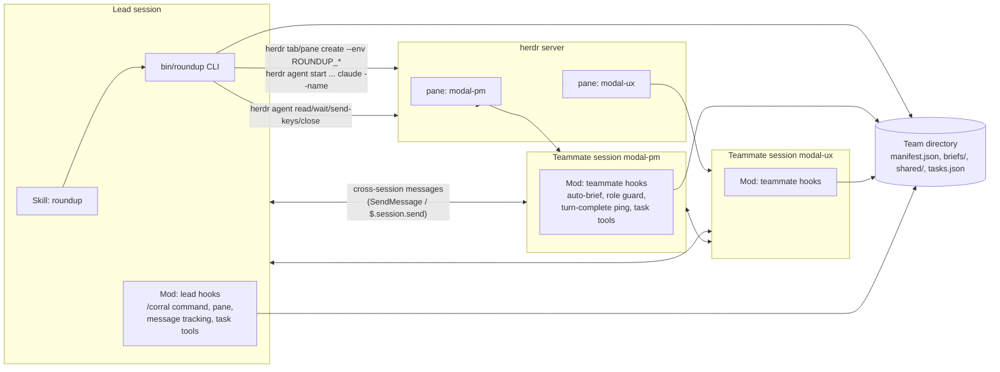
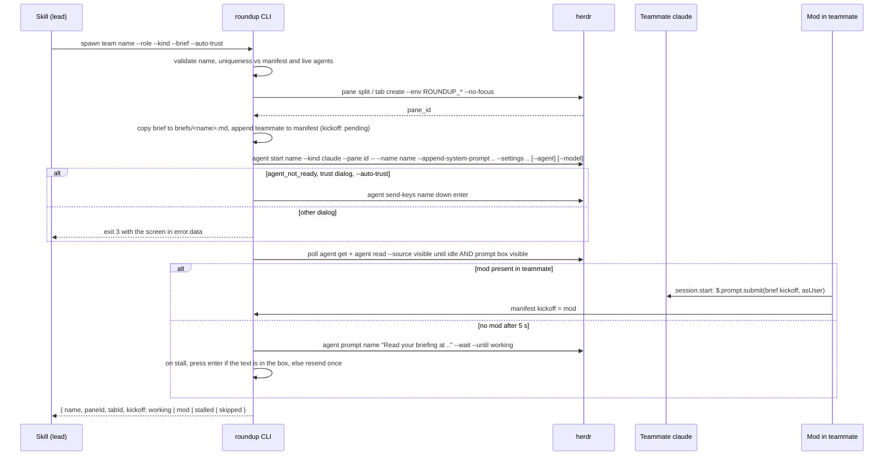
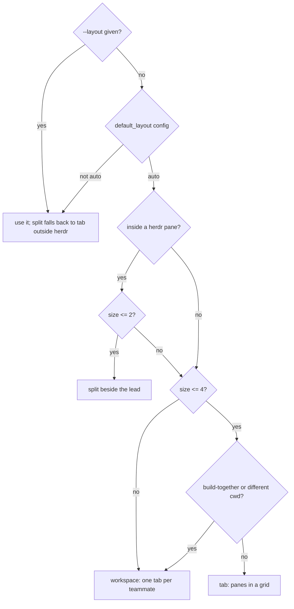
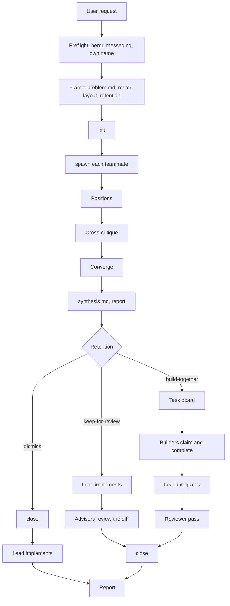

# Architecture

roundup is three cooperating pieces in one plugin. Each works without the others where it can: the skill plus the CLI is a complete team runner, and the mod layers reliability and visibility on top.



## Two channels

| Channel | Carries | Mechanism |
| :- | :- | :- |
| Lifecycle | create and close panes, start sessions, read screens, observe idle/working/blocked, answer dialogs | herdr CLI, always through `src/herdr.mjs` as an argv array |
| Content | briefs, positions, critiques, decisions, status | Cross-session messaging: `SendMessage` and `ListAgents` from the model, `$.session.send` from the mod |

The two never mix. A typed prompt (`roundup prompt`) carries the user's authority and is reserved for kickoff and redirection; everything else between sessions is a peer message.

## How a teammate learns who it is

`roundup spawn` passes `ROUNDUP_TEAM`, `ROUNDUP_NAME`, `ROUNDUP_KIND`, `ROUNDUP_LEAD`, `ROUNDUP_LEAD_SESSION_ID`, `ROUNDUP_DIR`, and `ROUNDUP_BRIEF` with `--env` when it splits a pane or creates a tab. The shell in that pane inherits them, `claude` inherits them from the shell, and the mod reads them with `$.env.get` at `session.start`.

The first teammate of a `tab` or `workspace` layout takes the root pane the container was created with, before that teammate had a name. `roundup init` therefore stamps the team-level variables on the container, and the mod finds that teammate in the manifest by `HERDR_PANE_ID`, which herdr sets in every pane. Both paths were verified against a live herdr server.

## Spawn sequence



## Layout decision



Grid placement: in `tab` layout the first teammate takes the root pane and teammate `k` splits off teammate `floor((k-1)/2)`, right for odd `k` and down for even, so four members fill a 2x2. In `split` layout the first teammate splits right off the lead's pane and later ones stack. In `workspace` layout the first teammate takes the root tab, renamed, and each later one gets its own tab.

## Lifecycle



## The mod's two personalities

Decided once at `session.start`:

| | Teammate (`ROUNDUP_*` present, or pane found in a manifest) | Lead (everything else) |
| :- | :- | :- |
| `session.start` | status line; submit the brief as the user and stamp `kickoff: mod`; register task tools | `$.session.id()`; register `/corral`; follow the open team naming this session, or the only open team; poll every 5 s |
| `tool.check` | deny Edit, Write, NotebookEdit, and write-shaped Bash for advisors and reviewers, except under the team directory | pass through |
| `prompt.compose` | append a role reminder that survives compaction | pass through |
| `turn.complete` | ping the lead with the answer's first line, at most every 20 s | pass through |
| `session.receive` | log to `shared/log/<name>.jsonl` | track each teammate's last message for the pane |
| `command.run /corral` | n/a | status, pane, use, init, task, close |
| `ui.render Pane` | n/a | teammates with state, last message, focus and release buttons, task summary |
| `tool.call mcp__roundup__task_*` | list, claim next, complete as this teammate | the same as the lead |

Every hook is a no-op outside a team, so the plugin is inert in ordinary sessions.

## Team state on disk

```text
~/.claude/roundup/<team>/
├── manifest.json      # ids, layout, retention, lead, teammates with pane ids and kickoff state, released, status
├── settings.json      # {"crossSessionInbound":"accept"}, passed to every teammate
├── briefs/<name>.md
├── shared/            # problem.md, synthesis.md, <name>-notes.md, log/<name>.jsonl
├── tasks.json         # build-together only
└── tasks.lock/        # mkdir lock while a task mutation runs
```

The manifest is written whole through a temp file and rename. The CLI and the mod both write it; the mod only ever changes one teammate's `kickoff`, re-reading immediately before writing. The task board has stricter rules: every mutation runs under the lock directory, and a lock older than ten seconds is reclaimed as stale.
